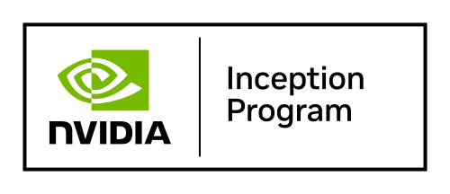
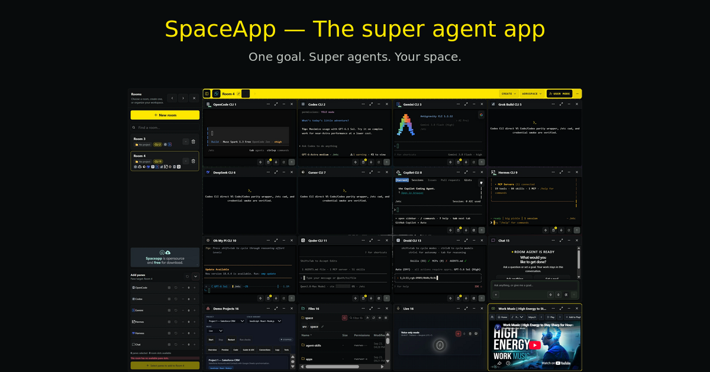

<p align="center">
  <a href="https://oll4.com/?utm_source=github&utm_medium=readme"></a>
</p>

<h3 align="center">🏅 Accepted into Anthropic’s Claude for Startups program.<br>Enrolled in the OpenAI Partner Network.</h3>

<p align="center"><sub>Through SpaceApp's maker, oll4.com, since October 2026. Membership in a program is not an endorsement of SpaceApp by Anthropic, OpenAI or NVIDIA.<br>© 2025 NVIDIA, the NVIDIA logo, and NVIDIA Inception are trademarks and/or registered trademarks of NVIDIA Corporation in the U.S. and other countries.</sub></p>

<p align="center"><br><br><br>SpaceApp is a member of NVIDIA Inception.<br><br></p>

<p align="center">
  <a href="https://spaceapp.dev/?utm_source=github&utm_medium=readme"></a>
</p>

<h1 align="center">One goal. Super agents. Your space.</h1>

<p align="center"><b>A self-hosted workspace where your AI coding agents work side by side,<br>and one mind runs them for you. On your machine, from any device.</b></p>

<p align="center">
  <a href="#-quick-start"></a>
  <a href="https://spaceapp.dev/spaceappmock/?utm_source=github&utm_medium=readme"></a>
  <a href="https://spaceapp.dev/?utm_source=github&utm_medium=readme"></a>
</p>

<p align="center">
  <a href="https://github.com/oll4com/spaceapp/releases"></a>
  <a href="https://www.npmjs.com/package/run-spaceapp"></a>
  <a href="LICENSE"></a>
  
  <a href="https://discord.gg/dUszP7HpmS"></a>
  <a href="https://sentry.io/?utm_source=spaceapp&utm_medium=readme"></a>
</p>

---

## 🌟 What is SpaceApp?

SpaceApp is a web app you run on your own machine with Docker. It replaces a wall of terminal windows with **rooms**: each room holds **panes**, and each pane is an AI coding CLI, a copilot, a browser or a tool.

<p align="center">
  Run <b>OpenCode</b>, <b>OpenAI Codex</b>, <b>Claude Code</b>, <b>Google Gemini</b>, <b>Qwen</b>, <b>Kimi</b>, <b>Grok</b>, and <b>DeepSeek</b> concurrently in persistent rooms on your own machine. Rooms organize sessions; they are not a security boundary between mutually untrusted users.
</p>

<table>
  <tr>
    <td align="center" width="24%">🧑‍💻<br><b>You</b><br><sub>browser · phone · Telegram</sub></td>
    <td align="center" width="4%">➜</td>
    <td align="center" width="28%">🧠<br><b>Nous, one mind</b><br><sub>does the routine work, asks you only what needs you</sub></td>
    <td align="center" width="4%">➜</td>
    <td align="center" width="40%">🗂️<br><b>Rooms of panes</b><br><sub>AI coding CLIs · copilots · studios · browsers · files</sub></td>
  </tr>
  <tr>
    <td colspan="5" align="center">Every pane shares 💾 <b>Space Memory</b> · 🔐 <b>Vault</b> · 🚪 <b>Space Gateway</b> · 🧩 <b>skills and MCP servers</b></td>
  </tr>
</table>

Work in any pane yourself, or give Nous a goal and let it run the panes. Every CLI runs on **your own account**.

<p align="center">
  
</p>

## ✨ What's inside

<table>
  <tr>
    <td width="33%" valign="top"><h3>🤖 16 AI coding CLIs</h3>Run up to 16 AI coding assistants, terminals and tools per room. Rooms stay warm, so their sessions keep running when you switch.</td>
    <td width="33%" valign="top"><h3>🧠 Nous</h3>Reads every pane's progress, sends the next steps, works on your <code>/goal</code> and asks you only about releases, deletes, third parties and direction. Off until you turn on <b>Work on my behalf</b>.</td>
    <td width="33%" valign="top"><h3>🧭 6 copilots</h3>Mail, Job, Marketing, Freelance, Security and Monitoring: the work around the code, with as much autonomy as you choose.</td>
  </tr>
  <tr>
    <td width="33%" valign="top"><h3>🎨 3 studios</h3>Design, Video and App Studio make graphics, videos and mobile apps for any agent that asks.</td>
    <td width="33%" valign="top"><h3>🔐 Vault and Gateway</h3>The Vault fills your logins without showing them to agents. Space Gateway uses your subscriptions first and your API key last.</td>
    <td width="33%" valign="top"><h3>💾 Shared memory</h3>Decisions and project knowledge that every agent session reads and writes, shown as a 3D graph.</td>
  </tr>
</table>

<p align="center">
  
  <br><sub>The Copilots room in the <a href="https://spaceapp.dev/spaceappmock/?utm_source=github&utm_medium=readme">interactive demo</a>, with invented data. Every tool is described in the <a href="https://spaceapp.dev/docs/tools/?utm_source=github&utm_medium=readme">tools guide</a>.</sub>
</p>

---

## ⚡ Quick start

One command on Linux, macOS or Windows 11. Docker is installed automatically if it is missing:

```bash
npx --yes run-spaceapp@latest install
```

1. The launcher checks CPU, RAM and disk, and installs or starts Docker.
2. It checks the SBOM and provenance attestations of SpaceApp's images, pulls them by the digest the npm package pins and starts the stack.
3. It prints a 15-minute setup token and opens `http://127.0.0.1:4911`.
4. You paste the token and create your owner account.
5. The Getting Started room opens with **OpenCode**: check its model, sign in if it asks, and give it a small task.

> **Windows:** use Command Prompt (`cmd.exe`). If PowerShell blocks scripts, run `npx.cmd --yes run-spaceapp@latest install`.

Copilots and studios are optional modules: turn one on with `optionalModules` in the launcher's `config.json`, then run `repair`. What a self-hosted install cannot do yet is in the [Known Limitations](docs/quality/KNOWN_LIMITATIONS.md).

## 🧠 Nous

Nous is SpaceApp's own agent. It reads every pane's progress, sends the next steps and works on your goals (`/goal <what you want>` in its composer) in turns of its own until they are done. It asks you before releases, deletes, anything to third parties or money, and changes of direction; the allowances that let it do more alone are off until you turn them on.

From `run-spaceapp` 1.2.0 Nous runs on a self-hosted install too: each turn is a headless Claude Code run in `spaceapp-cli` on **your own Claude Code login**, with lean defaults. Connect Claude Code, then switch on **Work on my behalf** in the Nous dock. Goals, allowances, tools, the install path, a goal from start to finish and the limits of a self-hosted install: [Nous guide](docs/nous.md).

## 🏗️ Under the hood

A Docker Compose stack. The launcher picks the largest profile your machine fits, or you pass `--profile <name>`:

| Profile | Containers | Needs |
| :--- | :--- | :--- |
| `small` | `spaceapp-core` (web app and API) · `spaceapp-cli` (the AI CLIs) · `postgres` (data and pgvector memory) | 4 CPUs, 7 GiB RAM, 6.5 GiB disk |
| `medium` | small + `temporal` (background workflows) | 4 CPUs, 11 GiB RAM, 8 GiB disk |
| `large` | medium + `spaceapp-browser` (managed Chrome) | 8 CPUs, 15 GiB RAM, 11 GiB disk |

- **Your files:** the containers see none of your host files until you register a folder with `workspace add <path>` (`--read-only` for reference repos). Containers are not a sandbox against a hostile workload; read the [trust boundaries](docs/architecture.md#trust-boundaries).
- **The code:** a TypeScript monorepo: `apps/web` (React), `apps/api` (Fastify), `apps/worker` (Temporal) and shared `packages/` (contracts, db, runtime, gateway, run-spaceapp launcher, …). Development requires Node **>=26.13 <27**; see [Contributing](CONTRIBUTING.md).

## 💻 Everyday commands

Run `npx --yes run-spaceapp@latest <command>`, or `spaceapp <command>` after `npm install -g run-spaceapp`:

| Command | What it does |
| :--- | :--- |
| `up` · `down` · `status` · `logs` | Start, stop and check the stack |
| `update` · `rollback` | Update the images, or go back to the previous ones (database changes stay; use `restore` for those) |
| `backup` · `restore` | A checksummed archive of the database, settings and memory |
| `workspace add <path>` | Let agents work in one of your folders |
| `provider install <name>` | Add an AI coding CLI (`codex`, `claude`, `gemini`, `qwen`, …) |
| `credentials set <provider>` | Save an API key through masked input |
| `doctor --fix` | Find and repair install problems |
| `owner reset-password` · `owner rotate-setup-token` | Forgotten password, or an expired setup token |

Every command and option: [Operations guide](https://github.com/oll4com/spaceapp/blob/main/docs/operations.md).

## 🧩 Supported AI Coding Agents

| Assistant | Sign-in |
| :--- | :--- |
| **OpenCode** | The first CLI in setup; its provider catalog decides models and sign-in |
| **OpenAI Codex / Claude Code / Gemini CLI / Kimi Code / Grok Build** | Your provider account |
| **Qwen Code / DeepSeek CLI / Cursor / Copilot / Autohand / Hermes / Oh My Pi / Qoder / Muse / Droid** | Provider-dependent: an account login or API credentials |

Installed versions and your credentials decide what can run; see the [compatibility evidence and limitations](docs/quality/runtime-compatibility.md) and [CLI providers](https://github.com/oll4com/spaceapp/blob/main/docs/cli-providers.md).

## 📚 Learn more

[Getting started](https://github.com/oll4com/spaceapp/blob/main/docs/getting-started.md) ·
[Nous](docs/nous.md) ·
[Architecture](docs/architecture.md) ·
[Security model](docs/security-model.md) ·
[Claims audit](docs/quality/claims-audit.md) ·
[Contributing](CONTRIBUTING.md) ·
[Support](https://github.com/oll4com/spaceapp/blob/main/SUPPORT.md) ·
[Security disclosures](https://github.com/oll4com/spaceapp/blob/main/SECURITY.md) ·
[Discord](https://discord.gg/dUszP7HpmS)

## 📄 License

SpaceApp is licensed under the [MIT License](LICENSE). The copyright holder is INTRATRADE SINGLE MEMBER P.C. (Greek: INTRATRADE ΜΟΝΟΠΡΟΣΩΠΗ Ι.Κ.Ε.), the company that develops SpaceApp. Contributions are accepted under the MIT License with a Developer Certificate of Origin 1.1 sign-off.

<sub>Every published version keeps the license it was released under: v0.1.3 to v1.0.2 under the Apache License, Version 2.0, and v1.0.31 to 1.1.6 under the Business Source License 1.1; SpaceApp and the `run-spaceapp` launcher are MIT from 1.1.7. <!-- claims:historical --> Parts taken from other projects keep their own license (`THIRD_PARTY_LICENSES`), and the integrated AI CLIs stay under their providers' terms ([Third-Party Notices](https://github.com/oll4com/spaceapp/blob/main/THIRD_PARTY_NOTICES.md)).</sub>
