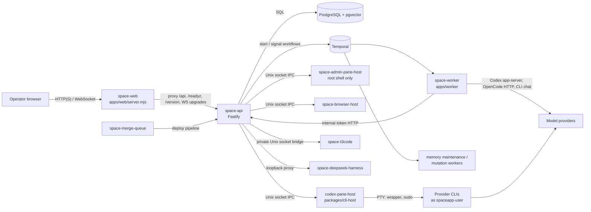
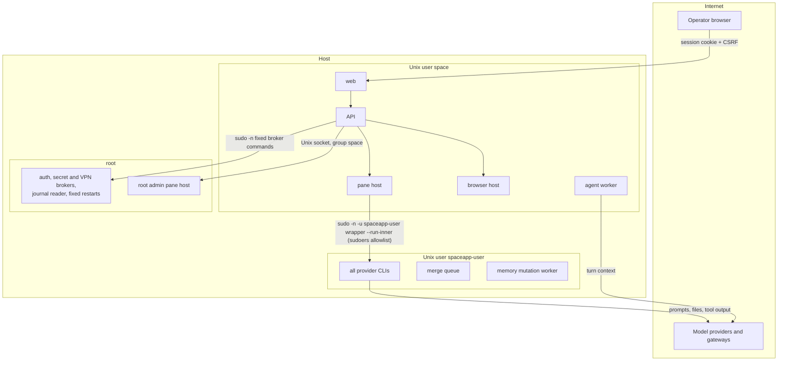
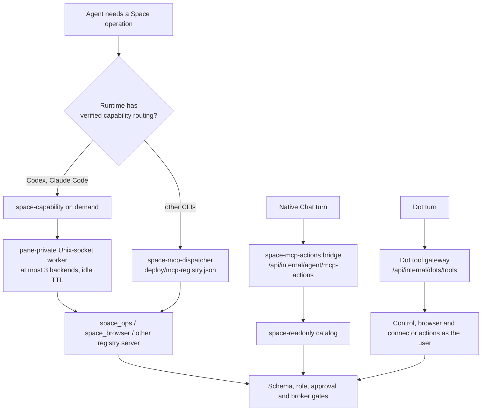
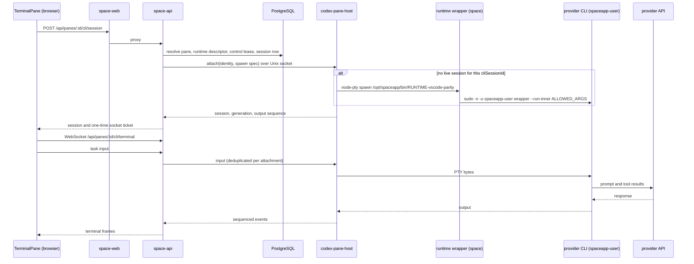
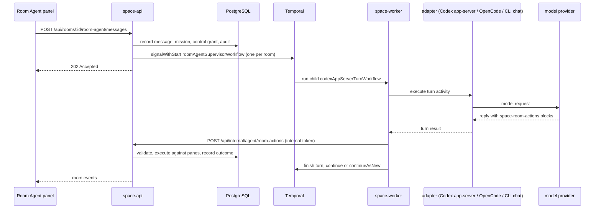
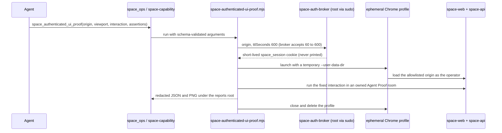
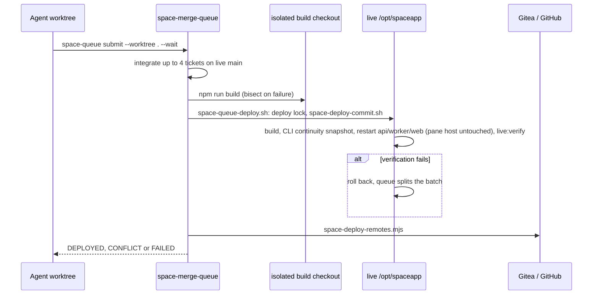

# SpaceApp architecture map

This map is derived from the source tree, the systemd units in `deploy/` and the
operator runbooks. It describes how the code is built to run. It does not certify
a particular installation: the public `run-spaceapp` launcher, the container
images and the operator host can run different versions and configurations. The
platform version lives in `version.json`; `npm run check:claims` verifies that
the version, licence, Node requirement, runtime list and the constants quoted
here and in the README match the code.

**Reading this in the public repository.** This map describes the maintainers'
development host: `deploy/`, `version.json`, `npm run check:claims` and
`docker-compose.yml` are not part of the public tree, and the trust-boundary
section below is that host's sudoers model. A public install runs the Docker
Compose packaging of `packages/run-spaceapp/templates/compose.yml`; its trust
boundaries are in `docs/security-model.md`.

Related documents:

- System topology and trust notes (earlier source map; still accurate for the diagrams it contains).
- [State ownership](quality/state-ownership.md), [failure matrix](quality/failure-matrix.md), [runtime compatibility](quality/runtime-compatibility.md).
- [Claims audit](quality/claims-audit.md): every performance, isolation and continuity claim with its evidence or its rewording.

## Contents

1. [Component map](#component-map)
2. [Entrypoints](#entrypoints)
3. [Trust boundaries](#trust-boundaries)
4. [Native tools and MCP routing](#native-tools-and-mcp-routing)
5. [Orchestration versus agent reasoning](#orchestration-versus-agent-reasoning)
6. [Sequence diagrams](#sequence-diagrams)
7. [State ownership](#state-ownership)
8. [Feature status](#feature-status)

## Component map

### Processes

| Process | Unit (`deploy/`) | Unix user | Entrypoint | Listens on |
| --- | --- | --- | --- | --- |
| Web server | `space-web.service` | `space` | `apps/web/server.mjs` | `SPACE_WEB_PORT` (default 4911); proxies `/api`, `/plugins`, `/healthz`, `/livez`, `/readyz`, `/version` and WebSocket upgrades to the API |
| API | `space-api.service` | `space` | `apps/api/dist/server.js` (source `apps/api/src/server.ts`) | `SPACE_API_HOST:SPACE_API_PORT`, default API `127.0.0.1:4910` and web `4911` |
| Agent worker | `space-worker.service` | `space` | `apps/worker/dist/worker.js` | Temporal agent-turn task queue `space-agent-turns` |
| Memory maintenance worker | `space-memory-maintenance-worker.service` | `space` | `apps/worker/dist/memory-maintenance-worker.js` | Temporal memory-maintenance task queue `space-memory-maintenance` |
| Memory mutation worker | `space-memory-mutation-worker.service` | `spaceapp-user` | `apps/worker/dist/memory-mutation-worker.js` | Temporal memory-mutation task queue `space-memory-mutations` |
| CLI pane host | `codex-pane-host.service` | `space` | `packages/cli-host/dist/main.js` | `/run/space-codex-pane-host/pane-host.sock` (mode 0660 in a 0700 runtime directory) |
| Root admin pane host | `space-admin-pane-host.service` | `root` | `packages/cli-host/dist/admin-main.js` | `/run/space-admin-pane-host/pane-host.sock`; accepts only runtime `cli:root` (`/bin/bash --login`) |
| Browser host | `space-browser-host.service` | `space` | `apps/api/dist/browser-host-main.js` | `/run/space-browser-host/browser-host.sock` |
| T3 Code | `space-t3code.service`, `space-t3code.socket` | `space-t3code` | `integration/start-server.mjs` of the pinned runtime | loopback port 3773; API bridge over `/run/space-t3code/transport.sock` |
| DeepSeek harness | `space-deepseek-harness.service` | `space-harness` | `dsh --profile web` | `127.0.0.1:3080` |
| Merge queue | `space-merge-queue.service` | `spaceapp-user` | `scripts/space-queue.mjs daemon` | none (file state in `/opt/spaceapp/var/merge-queue/`) |
| CLI resource guard | `space-cli-resource-guard.service` | `root` | `/opt/spaceapp/bin/space-cli-resource-guard` | none |
| Temporal | `docker-compose.yml` service `temporal` (development) | container | `temporalio/auto-setup` | `127.0.0.1:7233`, namespace `default` |
| PostgreSQL | `docker-compose.yml` service `postgres` (development) | container | `pgvector/pgvector` image | `127.0.0.1:54329` in development; the API uses `SPACE_DATABASE_URL` |

The public installer runs a different packaging (Docker Compose with
`spaceapp-core`, `spaceapp-cli`, PostgreSQL, Temporal and an optional
`spaceapp-browser`; see the README). In the public repository that compose file
is `packages/run-spaceapp/templates/compose.yml`, shipped with the `run-spaceapp`
package.

### Data stores

| Store | Owner | Notes |
| --- | --- | --- |
| PostgreSQL (`packages/db`) | API, workers | Rooms, panes, sessions, tasks, events, audit chain (`prev_hash`/`chain_hash`), artifact metadata, memory records and `vector` embeddings with HNSW indexes. Migrations: `packages/db/migrations/*.sql` via `packages/db/src/migration-runner.ts` |
| In-memory store (`packages/runtime/src/store.ts`) | API | Selected by `SPACE_RUNTIME_STORE=memory`, the source default; `postgres` needs `SPACE_DATABASE_URL`. Not durable |
| Temporal histories | Temporal | Workflow state for Room Agent supervisors, chat turns, Dot goals and memory jobs |
| CLI host buffers | Pane host | 8 MiB output ring per session (`SPACE_CLI_HOST_OUTPUT_BUFFER_BYTES`), lost if the host restarts; the API also stores transcript chunks in PostgreSQL (`pane_cli_transcript_chunks`), except for LOGIN sessions |
| Provider-native sessions | Provider CLIs | Files under the CLI state roots in `/var/lib/spaceapp-user` (for example `~/.codex`); not in PostgreSQL backups |
| Artifact bytes | API filesystem | Hash-identified files with a reconciliation journal ([upload reconciliation](quality/upload-reconciliation.md)) |
| Canonical memory sources | Memory mutation worker | Approved canonical files plus a mutation journal |
| Merge-queue state | Merge queue | `/opt/spaceapp/var/merge-queue/` (tickets, logs, integration and build worktrees) |
| Browser-local settings | Web client | `localStorage` keys such as `space.warmRoom.connectedPaneLimit.v1`; per browser |

## Entrypoints

| Area | Entrypoint (source) | What happens there |
| --- | --- | --- |
| Web client | `apps/web/src/main.tsx`, `apps/web/src/App.tsx` | Shell, rooms, pane grid, warm-room cache (`room-runtime-cache.ts`, `warm-room-settings.ts`) |
| Terminal pane | `apps/web/src/features/terminal-pane/TerminalPane.tsx` | xterm.js, WebSocket `/api/panes/:id/cli/terminal`, reconnect watchdog (15 s) |
| API process | `apps/api/src/server.ts` -> `createApp` in `apps/api/src/app.ts` | Configuration (`config.ts`, `t3-env.ts`), auth/CSRF (`auth.ts`), rate limits, route registration, service composition |
| CLI sessions | `apps/api/src/cli-terminal.ts` (`CliTerminalManager`), `packages/cli-host/src/client.ts` | Start, attach, input, resize, interrupt, resume over the pane-host socket |
| Runtime registry | `apps/api/src/cli-runtime-descriptors.ts` | 16 CLI descriptors: command wrapper, auth mode, state root, native resume arguments, default model |
| CLI wrappers | `deploy/<runtime>-vscode-parity` installed as `/opt/spaceapp/bin/<runtime>-vscode-parity` | Outer mode as `space` re-executes `sudo -n -u spaceapp-user <wrapper> --run-inner <args>`; inner mode runs the managed CLI from `/opt/spaceapp/var/cli-versions/<runtime>/current`; the droid, muse, omp, qoder and hermes wrappers run a system or home-directory binary instead |
| Room Agent | `apps/api/src/room-agent.ts` (`TemporalRoomAgentWorkflowCoordinator`), routes `/api/rooms/:id/room-agent/*` | Persists the request and signals the per-room supervisor workflow |
| Chat and turn dispatch | `apps/api/src/turns.ts` | Starts `codexAppServerTurnWorkflow` and `dummyTurnWorkflow` |
| Dot goals | `apps/api/src/dot-goals.ts` | Starts `dotGoalWorkflow` |
| Workers | `apps/worker/src/worker.ts`, `workflows.ts`, `activities.ts` | `roomAgentSupervisorWorkflow`, `roomAgentActionWorkflow`, `codexAppServerTurnWorkflow`, `dotGoalWorkflow`, `dummyTurnWorkflow`; adapters for Codex app-server, OpenCode HTTP and CLI chat |
| Memory workers | `apps/worker/src/memory-maintenance-worker.ts`, `memory-mutation-worker.ts` | `memoryMaintenanceWorkflow`, `memoryConsolidationWorkflow`, `memoryMutationWorkflow` |
| Pane host | `packages/cli-host/src/main.ts`, `session-registry.ts`, `server.ts` | PTY ownership, generation IDs, output sequence, inactive-session reaping |
| Browser host | `apps/api/src/browser-host-main.ts`, `packages/browser-host/src` | Chrome processes, profiles, frames, captures |
| Decision service | `apps/api/src/decisions-service.ts`, `decision-engine/` | Optional remote classifier calls (Jev) |
| MCP (API side) | `apps/api/src/mcp.ts`, `mcp-tool-executor.ts`, `dot-tools-gateway.ts` | Discovery from `SPACE_MCP_SERVERS_JSON`, policy-checked execution, Dot tool gateway |
| MCP servers | `scripts/space-ops-mcp.mjs` (`space_ops`, or `space-readonly` with `--readonly`), `scripts/space-control-mcp.mjs`, `scripts/space-browser-mcp.mjs` | Operations, operator-authorized room control, managed browser |
| Tool routing | `deploy/space-capability.mjs`, `deploy/space-mcp-dispatcher.mjs`, `deploy/mcp-registry.json` | Capability-first on-demand calls; legacy single dispatcher |
| Authenticated proofs | `scripts/space-authenticated-ui-proof.mjs`, `deploy/space-auth-broker` | Broker-issued short-lived session, ephemeral Chrome profile, redacted evidence |
| Delivery | `scripts/space-queue.mjs`, `space-queue-verify.sh`, `space-queue-deploy.sh`, `space-deploy-commit.sh`, `space-deploy-remotes.mjs` | Merge queue, isolated build, live deploy, remote push |
| Health | `GET /healthz`, `/readyz`, `/version`, `/metrics` in `app.ts` | Liveness, readiness (database check), version identity |

## Trust boundaries

The supported scope is a trusted operator deployment. Rooms and panes organize
work; they are not a security boundary between mutually untrusted users.

| Boundary | Mechanism | What it does not do |
| --- | --- | --- |
| Browser to API | Signed `space_session` cookie (HMAC with `SPACE_SESSION_SECRET`), CSRF header on mutations, Fastify rate limits (login: 10 attempts per 15 minutes) | Revocations persist in PostgreSQL (signature SHA-256 and per-user epochs) and survive restarts; while the database is unreachable they apply in memory only ([security model](security-model.md)) |
| Pane host (`space`) to provider CLIs (`spaceapp-user`) | 16 `deploy/space-<runtime>-vscode-parity.sudoers` files: `space ALL=(spaceapp-user)` limited to the wrapper's `--run-inner` forms. The codex, opencode and qwen entries use anchored regexes; the others list fixed forms and some `*` wildcards (for example `--resume *`). 11 of the 16 wrappers also filter arguments (`require_allowed_args`); droid, hermes, muse, omp and qoder do not | Every provider CLI runs as the same Unix user, so panes and runtimes can read each other's files and credentials |
| API (`space`) to root helpers | 16 `space ALL=(root)` entries for fixed commands: auth broker, source-control secret broker, CLI VPN broker, journal reader, DOCX normalizer, agent-tools writer, CLI maintenance dispatcher, CLI update control, release control, memory reclaim, Codex usage/credits helpers, and fixed `systemctl` restarts (T3 Code, DeepSeek harness, OpenCode shared server, core restart) | A helper is only as narrow as its own argument validation |
| Root admin shell | Separate root pane host that accepts only `cli:root`; API feature flag `SPACE_CLI_ROOT_ENABLED` (off by default) | Full root on the host once enabled |
| Authenticated proofs | `sudo -n /opt/spaceapp/bin/space-auth-broker` (root) issues a session cookie for an allowlisted origin with a TTL of 60 to 600 s; the proof uses a temporary Chrome profile and writes redacted JSON/PNG under the reports root | The proof drives the real operator account and live API; it is not a sandbox |
| CLI agents to protected operations | `space_ops` full catalog (7 tools): `space_status`, `space_logs`, `space_scoped_test`, `space_authenticated_ui_proof`, `space_clip_paste_proof`, `space_live_verify`, `space_deploy_commit`. | Gated tools still need their own arguments (`confirmLiveWrite`, exact SHAs) |
| Native Chat agents | `space-readonly` catalog (3 tools): `space_status`, `space_logs`, `space_authenticated_ui_proof`. Reached through `space-mcp-actions` blocks that the worker posts to `/api/internal/agent/mcp-actions` | Tests and deploy are never offered to native agents |
| Room Agent control | `space-control` MCP server with a dedicated CLI token and room grant; requires an authenticated ADMIN operator context | Phase one supports Codex CLI adapters only |
| Dots tool gateway | `space_search_tools`, `space_describe_tool`, `space_call_tool` for Control, browser and connector actions (`/api/internal/dots/tools/*`); each call is re-authorized against run, Dot, room and user and recorded in `dot_tool_invocations`; sensitive actions wait for owner approval | Kill switch `SPACE_DOT_TOOL_GATEWAY=disabled` |
| Worker to API | `POST /api/internal/agent/room-actions` with `x-space-internal-token` | Any process holding the internal token can submit room actions |
| Host filesystem (installer) | Registered bind mounts; optional Linux host-root access | Containers are not a sandbox against a hostile workload |
| Providers | Remote model providers receive the context the CLI or adapter sends | Self-hosting does not keep prompts local |

## Native tools and MCP routing

Tool access is capability-first (ADR-010):
the runtime's own tools (shell, file edits, vision) are used first, and Space
operations are reached on demand.

- New Codex and Claude Code panes register no MCP server at startup; protected
  operations go through `space-capability`, which reads cached schemas and
  starts only the selected backend on the first real call.
- Other runtimes keep the single dispatcher, which spawns registry servers on
  demand and stops them after `idleTtlMs`.
- MCP is a tool transport. It is not on the path of every model request, and a
  declared tool grants neither authorization nor control.

## Orchestration versus agent reasoning

| Concern | Who decides | Where |
| --- | --- | --- |
| Planning, code edits, tool choice inside a CLI | The provider CLI and its model | Provider process; Space sees PTY output and, for some runtimes, native session files (for example Codex rollouts) |
| Chat and Room Agent replies | The model behind the adapter (Codex app-server, OpenCode, CLI chat) | Worker activities |
| Which room actions run | The model proposes `space-room-actions` blocks; Space parses them against the action schemas and the room inventory, and the API authorizes and executes them | `apps/worker/src/room-action-bridge.ts` -> API internal route |
| Session lifecycle (start, attach, interrupt, resume) | Space | API, pane host, runtime descriptors |
| Durable multi-step work (Room Agent missions, Dot goals, memory jobs) | Space, through Temporal workflows with fixed retry policies | `apps/worker/src/workflows.ts` |
| Managed Codex plan stages | Space's in-API controller with fenced leases | `apps/api/src/plan-execution-controller.ts` |
| Safety and routing classifications | Optional remote decision service (Jev); its output gates specific steps | `apps/api/src/decisions-service.ts` |
| Automatic model routing | Not applied; recorded in shadow mode only | Dots stage 7 |
| Delivery to live | Merge queue | `scripts/space-queue.mjs` |

Retry policy matters for side effects: OpenCode and CLI chat turns run with one
attempt because the prompt send is not idempotent; Room Agent and native chat
turns allow up to 5 attempts; Dot goal steps use idempotent step keys.
No exactly-once delivery is claimed ([failure matrix](quality/failure-matrix.md)).

## Sequence diagrams

### CLI pane task

An API restart closes the WebSocket but not the PTY; the browser reconnects and
the host replays from its buffer. A process exit or a `RUNNING` status is not
evidence that a task succeeded.

### Room Agent turn

### Authenticated proof

### Deploy through the merge queue

## State ownership

The detailed table is [state-ownership.md](quality/state-ownership.md). In short:

- PostgreSQL owns application intent and status; it never proves that a native
  session or task exists.
- The pane host owns running PTYs and their recent output; the provider owns its
  conversation files; resume needs a supported native identity.
- Temporal owns workflow progress; activities record outcomes back to
  PostgreSQL.
- Artifact metadata and bytes have separate owners and a reconciliation journal.
- The warm-room cache is derived browser state: six warm rooms with the
  default/maximum 96 connected panes and timed parking disabled.
- Session revocations are process memory (see [security model](security-model.md)).

## Feature status

Status labels:

- **Implemented**: wired and enabled without a feature flag, with tests. Several features also need the PostgreSQL store (`SPACE_RUNTIME_STORE=postgres`), which the installer and the operator deployment use.
- **Implemented (opt-in)**: wired and tested, off by default in source; enabled per deployment by the named setting.
- **Experimental**: shipped as a canary, shadow or declaration, or still missing the acceptance proof named in its own docs.
- **Planned**: not implemented; tracked as open work.

| Feature | Status | Code evidence | Limits and open items |
| --- | --- | --- | --- |
| Rooms (max 6) and panes (max 16 per room), deterministic names | Implemented | `packages/contracts/src/room-names.ts`, `pane-names.ts`, `packages/runtime/src/store.ts` (`ACTIVE_PANE_CAP`), `POST /api/rooms` | Rooms are not a security boundary |
| Independent CLI pane host | Implemented | `packages/cli-host`, `deploy/codex-pane-host.service`, `scripts/verify-cli-host-service-restart.mjs` | Authenticated end-to-end continuity proof is open ([failure matrix](quality/failure-matrix.md)) |
| Terminal reconnect watchdog | Implemented | `TerminalPane.tsx` (`TERMINAL_SOCKET_WATCHDOG_INTERVAL_MS`) | |
| Warm-room cache (6 rooms, 96 connected panes, parking disabled) | Implemented | `apps/web/src/room-runtime-cache.ts`, `warm-room-settings.ts` | Latency gate failing on live (PERF-001); see [benchmark record](quality/claims-audit.md#warm-room-switch-benchmark) |
| 16 CLI runtime adapters | Implemented | `apps/api/src/cli-runtime-descriptors.ts`, `deploy/*-vscode-parity`, `deploy/*.sudoers`; contract suite `apps/api/tests/cli-adapter-runtime-contract.test.ts` | Declarations are `DECLARED_ONLY` with structured limitations; no live proof per runtime |
| Exact native resume: Codex, Claude Code, OpenCode, DeepSeek | Implemented | Recorded native references per runtime; `apps/api/tests/cli-resume-launch-admission.test.ts` checks each resume argv against the wrapper filter and sudoers | Live resume proof only where recorded in [runtime compatibility](quality/runtime-compatibility.md) |
| Targeted native resume: Qwen, Gemini | Experimental | Qwen: `deploy/qwen-task-metadata.mjs` and an anchored sudoers regex; Gemini: the wrapper steers `--continue` to the recorded conversation | No live resume proof yet |
| Exact native resume: Kimi, Grok, Cursor, Copilot, Hermes, OMP, Qoder, Muse, Droid | Planned | Provider session selection today | Needs sudoers changes and live checks ([native resume matrix](quality/native-resume-matrix.md)); Autohand has no native resume and no plan for it |
| Root admin shell pane | Implemented (opt-in) | `packages/cli-host/src/admin-main.ts`, `admin-policy.ts` | `SPACE_CLI_ROOT_ENABLED` |
| Room Agent (Temporal supervisor) | Implemented (opt-in) | `apps/api/src/room-agent.ts`, `roomAgentSupervisorWorkflow` | Needs `SPACE_AGENT_PANE_ENABLED` and `SPACE_ENABLE_CODEX_TURNS`; continuation input bound: CORE-008 is recorded as fixed in `review-findings.json` but still listed open in the failure matrix |
| Room pane commands | Experimental | `SPACE_ROOM_PANE_COMMANDS_ENABLED` | Off by default; room-agent v3 notes. The Room Agent's mini router was removed on 2026-10-13: its conversation (Room Agent v2) runs every message that is not a direct command. |
| Chat pane over Codex app-server | Implemented (opt-in) | `codexAppServerTurnWorkflow`, `packages/codex-app-server` | `SPACE_CODEX_APP_SERVER_ENABLED`, `SPACE_ENABLE_CODEX_TURNS` |
| CLI chat turns | Implemented (opt-in) | `runCliAgentTurn` | `SPACE_ENABLE_CLI_CHAT_TURNS`; one attempt per turn |
| Swarm execution | Experimental | `apps/api/src/swarm-routes.ts` | `SPACE_SWARM_EXECUTION_ENABLED`; stdio Codex turns only |
| Space Dots stages 1 and 3 (identity, tool catalog) | Implemented | `apps/api/src/dots-routes.ts`, `dot-tools-gateway.ts` | Needs the PostgreSQL store; see roadmap |
| Space Dots stage 4 (Goals) | Implemented (opt-in) | `apps/api/src/dot-goals.ts`, `dotGoalWorkflow` | `SPACE_ENABLE_CODEX_TURNS` and the PostgreSQL store |
| Space Dots stage 2 (Chat UI) | Experimental | Chat pane | Final authenticated proof pending |
| Space Dots stages 5 and 6 (connectors, Slack, Teams) | Experimental | `dot-connectors.ts`, `dot-channels.ts` | Live acceptance needs the user's consent and app registrations |
| Auto model routing | Experimental | Dots stage 7 shadow policy `auto-route-v1` | Recorded only; never applied |
| Managed Codex plan execution | Implemented | `apps/api/src/plan-execution-controller.ts` | Not a Temporal workflow; restart proof during a native turn open |
| Memory graph, maintenance and mutations | Implemented (opt-in) | `packages/memory-graph`, memory workers | `SPACE_MEMORY_GRAPH_ENABLED`, `SPACE_MEMORY_MAINTENANCE_ENABLED`, `SPACE_MEMORY_MUTATIONS_ENABLED`; embeddings need a provider |
| Browser panes and Google accounts | Implemented (opt-in) | `packages/browser-host`, `apps/api/src/browser-host-main.ts` | `SPACE_BROWSER_SESSIONS_ENABLED` |
| T3 Code pane | Implemented | `space-t3code.service`, `/api/t3code/*` | Needs the managed runtime installed; `SPACE_T3CODE_ENABLED=false` disables it |
| DeepSeek harness pane | Implemented (opt-in) | `apps/api/src/harness-proxy.ts` | `SPACE_HARNESS_ENABLED` |
| Source control and repository providers | Implemented | `features/source-control`, `/api/source-control/*` | Real-account proofs only against owned Gitea/Forgejo |
| Capability-first tool routing | Experimental | `deploy/space-capability.mjs`, ADR-010 | Canary for Codex and Claude Code; other runtimes use the dispatcher |
| Space MCP catalogs and Space Control | Implemented | `scripts/space-ops-lib.mjs`, `space-control-mcp.mjs` | |
| MCP tool execution through the API | Implemented (opt-in) | `apps/api/src/mcp-tool-executor.ts` | `SPACE_MCP_TOOL_EXECUTION_ENABLED` |
| CLI VPN egress | Implemented (opt-in) | `apps/api/src/cli-vpn.ts`, `scripts/cli-vpn-broker.mjs` (installed as `space-cli-vpn-broker`) | `SPACE_CLI_VPN_ENABLED` |
| Decision service (Jev) | Implemented (opt-in) | `apps/api/src/decisions-service.ts` | Needs an API key; remote provider |
| Telegram completion notifications | Implemented | `apps/api/src/telegram-routes.ts`, `apps/worker/src/telegram-notification-runtime.ts` | Needs a paired Telegram chat and bot token |
| Authenticated proof broker | Implemented | `deploy/space-auth-broker`, `scripts/space-authenticated-ui-proof.mjs` | Operator host only; not part of the public installer |
| Merge queue | Implemented | `scripts/space-queue.mjs` | Operator host only; merge commits from the resolver need owner review |
| Desktop (Windows, Linux) and Android clients | Implemented | `apps/desktop`, `apps/mobile`, `version.json` pillars | Separate release versions |
| Persistent session revocation | Planned | — | Today revocation is in memory per API process |
| Per-version CLI canary | Experimental | `scripts/cli-canary.mjs`, `deploy/space-cli-canary.service`/`.timer` (repository only, not installed) | Isolated `--version`/`--help` and launch-gate checks; never promotes ([runtime compatibility](quality/runtime-compatibility.md)) |
| Real-provider compatibility matrix | Planned | Version and static evidence in [runtime compatibility](quality/runtime-compatibility.md) | Live start/send/interrupt/resume/reconnect proofs per runtime |
| Temporal time-skipping tests and worker-kill recovery proof | Planned | — | CORE-006 |
| Distributed tracing, queue and recovery metrics | Planned | — | system topology |
| Measured production RPO/RTO and full restore | Planned | — | [postgres proofs](quality/postgres-proofs.md) |
| PERF-001 warm latency fix | Planned | — | Operator-approved bisect on an isolated staging origin |
